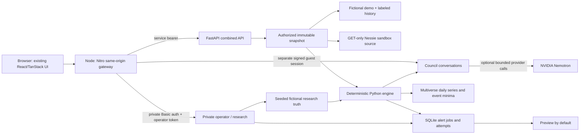

# Plutus V2 architecture

The existing Dashboard, spending/history presentation, cash planning, Simulator,
Cash Flow, Council, Passport, Trust Shield and Alerts remain. Multiverse extends
Simulator rather than importing an old application or replacing navigation.
Historical reference commits 4835326 and 97a08da supplied Raiyan's interaction
concepts; existing team code/history and attribution remain intact.

One combined FastAPI process owns data/ownership checks. Backend decimal arithmetic
remains in calculation_engine/simulator.py. JSON money uses decimal strings; client
integer-cent conversion is presentation, not a second forecast engine. Comparison
requests freeze one snapshot. New Multiverse explicitly bounds the horizon and
returns five daily series, event minima, differences and reserve breaches. Existing
v1 contracts remain supported. An explicit in-memory Council draft passes only
confirmed fields; fresh Council evidence is not falsely described as the old run.

Source modes are explicit and fail closed. Nessie is simulated banking retrieved
live from a sandbox HTTP API, not personal bank access. Cache expiry/source failures
never switch to demo. Demo mode has separate, labeled fictional history; research
is not an account source and never reads the configured banking adapter.

Production guest Council access is limited to an explicit public fictional demo.
Node's server bearer and separate session key stay out of browser bundles. Signed
guest identities, HttpOnly/SameSite/Secure cookies and per-conversation authorization
separate anonymous sessions. This is not an identity provider for real consumers.
Node pins its public origin; FastAPI enforces HTTPS, host, bearer, schemas and global
request/concurrency/body limits. Health checks reveal no financial/provider data.

Operator/research gates require opt-in private flags, Basic operator authentication
at Node, service authentication plus a separate operator token at FastAPI, and
same-origin mutation checks. Public deployment leaves private flags off. The
operator page shows job summaries and engine-backed checks, not shadow calculations,
recipient numbers or bank-mutation controls. Legacy mutation code is not installed.

Alert claims/events/jobs are committed together before transport. Durable submitting
claims prevent concurrent duplicate sends. Connection refusal before acceptance may
retry at most three times with backoff; timeouts, restart interruptions and accepted
submissions never retry automatically. Attempt outcomes are persistent and sanitized.
No provider-receipt callback exists, so no status asserts confirmed delivery.

SQLite is supported on one disk-backed backend instance/worker. Council histories
remain bounded temporary memory. This is an intentional bounded public-demo topology,
not a multi-instance production banking service. Horizontal scaling needs shared
conversation/job storage and distributed coordination; actual personal records need
identity-provider authentication and user-owned access controls.

Research pilot packs/version/seed determine fictional truth. Four controlled styles
vary presentation alone. No live model consultation is fabricated, no participant
collection endpoint exists, and offline export admits only synthetic test events.
See RESEARCH_MODE.md for approval boundaries and future model-generation work.
